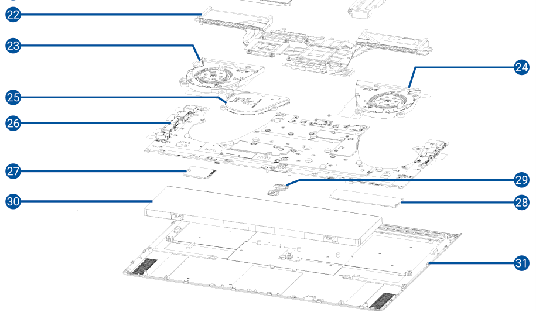
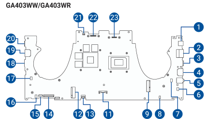

# Lab 3 — Teardown without a screwdriver

Pair: none    Driver first half: Kenenbayev Kadirzhan
Machine: ASUS ROG Zephyrus G14 GA403WR (host, Windows 11); Ubuntu Server guest in VMware Workstation (Part B)
Date: 01.11.2026

## 1. The machine

| What | Value | Where I got it |
|---|---|---|
| Manufacturer | ASUSTeK COMPUTER INC. | `Get-CimInstance Win32_ComputerSystem` → `Manufacturer` |
| Model | ROG Zephyrus G14 GA403WR | `Win32_ComputerSystem` → `Model`, `SystemFamily` |
| Board | GA403WR | `Get-CimInstance Win32_BaseBoard` → `Product` |

Service manual: ASUS **E26219**, *GA403W Service Manual*, First Edition, May 2025 — TODO: paste the link from asus.com/support.

The manual covers several variants (GA403WP/WM/WW/WR and GA403UP/UM/UH). Where a page shows a different
figure per variant, I used the one marked **GA403WW/GA403WR**. The manual does not give the SSD size code or the
memory maximum, so for those two facts I used a third source: Kingston's compatibility page for the G14 (2025)
GA403, which lists *SSD M.2 NVMe 2280 (single-sided)* and *0 DRAM sockets*
(https://www.kingston.com/en/memory/search/model/110497/asus-rog-zephyrus-g14-2025-ga403).

## 2. Components

Fragment of the exploded view, components 22–31 (manual p. 10, legend p. 11).
I chose the internal components because they decide what can be upgraded and how the machine is cooled;
numbers 1–21 are the lid, display, keyboard and case parts.

Connector numbers below refer to the board diagram (manual p. 91):

**22. What:** heat sink with heat pipes over the CPU and the GPU (p. 11, 45).
**Connects to:** sits on top of the motherboard; the board is removed with the heat sink still on it (p. 50).
**Limits:** uses liquid metal as the thermal interface — removal only by authorized service (p. 45).

**23. What:** CPU fan (p. 11, 39–41).
**Connects to:** CPU fan connector, #7 (p. 91).
**Limits:** one of only two fans on GA403WR (p. 41); together with the GPU fan it sets how long the CPU and GPU
can hold high clocks in a 14-inch chassis.

**24. What:** GPU fan (p. 11, 39–41).
**Connects to:** GPU fan connector, #17 (p. 91).
**Limits:** same as 23 — the second and last fan on this variant.

**25. What:** support fan, marked “on selected models” (p. 11).
**Connects to:** support fan connector, #10 (p. 91).
**Limits:** **not installed on GA403WR.** Page 41 shows three fans for GA403WP/WM/UP/UM/UH but only two for
GA403WW/WR, and the screw list on p. 39 matches (5 screws vs 9).

**26. What:** motherboard (system board) (p. 11, 45–50).
**Connects to:** everything — SSD, WLAN, fans, battery, display (eDP, #23), keyboard, touchpad, ports.
**Limits:** the CPU and the memory are part of the board — neither is listed as a separate part (see section 3).

**27. What:** WLAN module, an M.2 card held by one screw (p. 35–36).
**Connects to:** WLAN module connector, #9 (p. 91), plus the antenna cables (#3 on p. 10).
**Limits:** replaceable (screwed in, not soldered), but the antenna cables must be disconnected first (p. 36).

**28. What:** M.2 SSD module, NVMe (p. 28–34).
**Connects to:** SSD connector SSD1, #12 (p. 91).
**Limits:** one M.2 slot only, size 2280, single-sided drives only (Kingston page, section 1); installed with a
thermal pad, absorber sheet and aluminium foil sleeve that must go back on (p. 30–33).

**29. What:** battery cable (p. 11, 23–24).
**Connects to:** battery connector, #11 (p. 91).
**Limits:** must be disconnected by lifting the red-wire side first (p. 23).

**30. What:** battery (p. 21–25).
**Connects to:** the motherboard through the battery cable (29).
**Limits:** screwed in, not glued (p. 24); on GA403WR the SSD has to come out first (p. 21); puncture = fire risk (p. 23).

**31. What:** bottom cover (p. 14–18).
**Connects to:** the chassis, with screws including one pop-open screw (p. 14).
**Limits:** taking it off cuts system power automatically (p. 15).

## 3. Upgrade verdict

| Component | Manual says | OS says | Verdict |
|---|---|---|---|
| Memory | No memory module in the parts list (p. 11), no memory procedure in Chapter 2 (p. 3–4). Kingston: 0 DRAM sockets | `Win32_PhysicalMemoryArray`: MemoryDevices = 4, MaxCapacity = 64 GB. `Win32_PhysicalMemory`: 4 × 8 GB, FormFactor = 1 (Other, not 12 SODIMM), SMBIOSMemoryType = 35 (LPDDR5), Speed = 8000, channels A–D | **No:** 32 GB soldered LPDDR5X |
| Storage | One M.2 SSD module on connector SSD1 (p. 28–34, 91). Kingston: 2280, single-sided | `Get-PhysicalDisk`: BusType = NVMe, MediaType = SSD, WD PC SN5000S, 1 TB | **Yes, by replacement:** one slot, any single-sided M.2 2280 NVMe drive |
| CPU | Not a separate part; the board comes out with the heat sink on top (p. 50) | `Win32_Processor`: SocketDesignation = FP8LPDDR5x, UpgradeMethod = 1 (Other) | **No:** BGA, soldered |

**Where the manual and the OS disagree.** The firmware reports 4 memory devices and a maximum of 64 GB, which
looks like four slots and room to double the memory. The manual has no memory module at all, and the OS output
itself explains why: the form factor is not SODIMM, the type is LPDDR5, and the four “devices” are four memory
channels (BankLabel A–D) that all share the same DeviceLocator “DIMM 0”. I trust the manual: MaxCapacity comes
from a firmware table, and every tool that reads that table repeats the same number. Kingston's page (0 DRAM
sockets) agrees with the manual, not with the firmware.

## 4. The same machine in two OSes

| Fact | Windows (host) | Linux (Ubuntu VM) |
|---|---|---|
| CPU model | `Win32_Processor` Name = AMD Ryzen AI 9 HX 370 w/ Radeon 890M | `lscpu` Model name = AMD Ryzen AI 9 HX 370 w/ Radeon 890M |
| Physical cores | `Win32_Processor` NumberOfCores = 12 | `lscpu` Core(s) per socket × Socket(s) = 2 × 1 = 2 |
| Logical CPUs | `Win32_Processor` NumberOfLogicalProcessors = 24 | `lscpu` CPU(s) = 2 (Thread(s) per core = 1) |
| Cache | `Win32_Processor` L2CacheSize = 12288 KB, L3CacheSize = 24576 KB | `lscpu` L2 = 2 MiB (2 instances), L3 = 16 MiB (1 instance) |
| Total memory | `Win32_ComputerSystem` TotalPhysicalMemory = 33412722688 bytes (≈ 31.1 GiB) | `free -h` total = 3.3Gi |
| Memory type, speed | `Win32_PhysicalMemory` SMBIOSMemoryType = 35 (LPDDR5), Speed = 8000 | `dmidecode -t memory` Type = DRAM, Speed = Unknown, Form Factor = DIMM |
| Memory array | `Win32_PhysicalMemoryArray` MemoryDevices = 4, MaxCapacity = 64 GB | `dmidecode -t memory` Number Of Devices = 64, Maximum Capacity = 65 GB |
| Disk is SSD? | `Get-PhysicalDisk` MediaType = SSD | `lsblk` ROTA = 1 (rotational) |
| Disk interface | `Get-PhysicalDisk` BusType = NVMe | `lsblk` TRAN = spi, MODEL = VMware Virtual S |
| Motherboard | `Win32_BaseBoard` Manufacturer = ASUSTeK, Product = GA403WR | `dmidecode -t baseboard` Manufacturer = Intel Corporation, Product Name = 440BX Desktop Reference Platform |

The names differ most for the disk: Windows says `BusType`/`MediaType`, Linux says `TRAN`/`ROTA`, and the units
differ too (Windows gives memory in bytes, Linux in GiB). Every value from the VM except the CPU model is virtual:
the CPU model is passed through from the real processor, but VMware gives the guest only the 2 cores and 4 GB I
allocated, and invents the rest — a 1998 Intel 440BX board, 64 “DIMM” slots, a SCSI disk that claims to be
rotational even though it lives on an NVMe SSD. A VM lies about hardware by design, which is why Part A was done on
the host.

## What did not work the first time

1. **The path with a space.** `cd C:\GG\OSA github\labs\lab03-teardown\evidence` gave
   `PositionalParameterNotFound`. PowerShell treats a space as the end of an argument, so it saw `C:\GG\OSA` as
   the path and `github\labs\...` as an extra argument it did not know what to do with. Fix: put the whole path
   in quotes.
2. **`scp` was not found.** On Windows, `scp` gave `CommandNotFoundException` — PowerShell did not know the
   command. The program itself was there, in `C:\Windows\System32\OpenSSH\`, but the shell was not finding it by
   name. Fix: call it by its full path, `C:\Windows\System32\OpenSSH\scp.exe`.
3. **A backslash ate the quote.** `scp ... "C:\GG\OSA github\labs\lab03-teardown\evidence\"` failed with
   `No such file or directory` for a folder called `evidence"`. In Windows command lines `\"` means “a quote
   character inside the text”, so the closing quote became part of the folder name. Fix: drop the last backslash
   (or use `.` for the current folder).

## Evidence

- [evidence/manual-figures/components-22-31.png](evidence/manual-figures/components-22-31.png) — exploded view fragment from the service manual, p. 10
- [evidence/manual-figures/connectors-bottom.png](evidence/manual-figures/connectors-bottom.png) — motherboard connectors, p. 91
- [evidence/windows-specs.txt](evidence/windows-specs.txt) — PowerShell transcript on the host: model, memory array and modules, disk, CPU, board
- [evidence/linux-specs.txt](evidence/linux-specs.txt) — lscpu, free, dmidecode and lsblk inside the Ubuntu VM; every value except the CPU model is virtual
