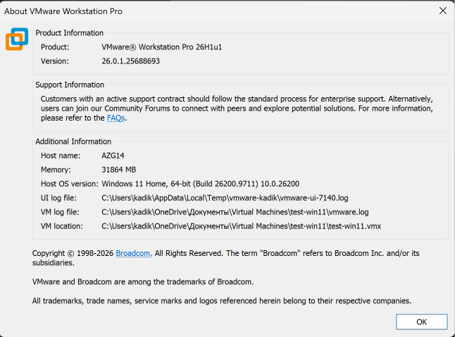
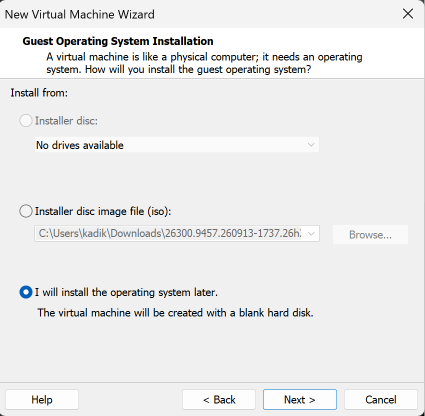
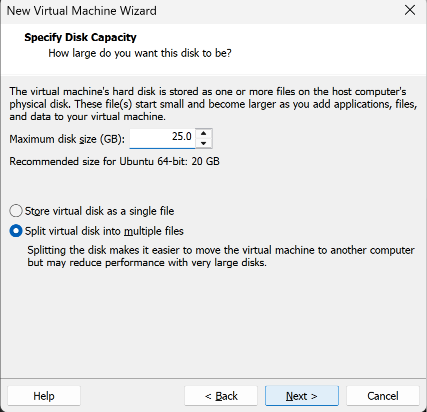
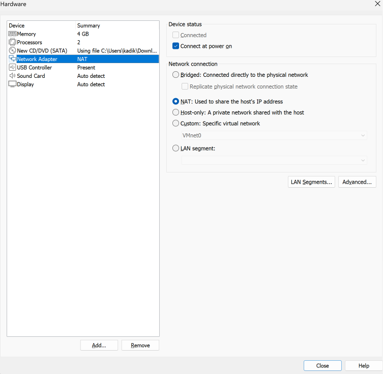
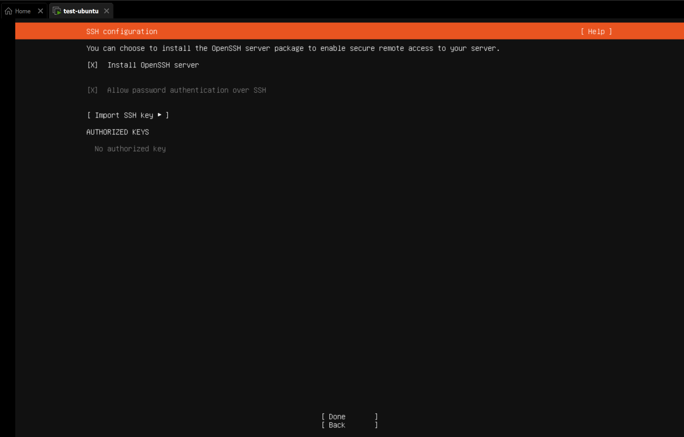
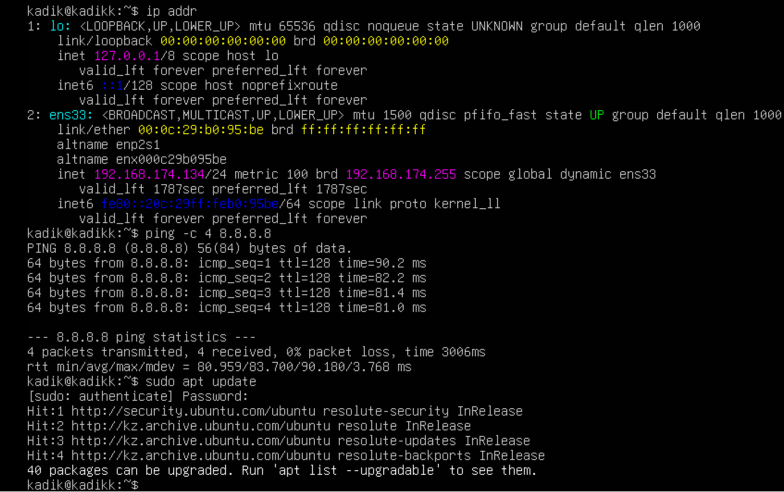
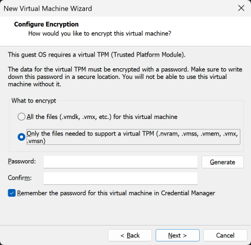
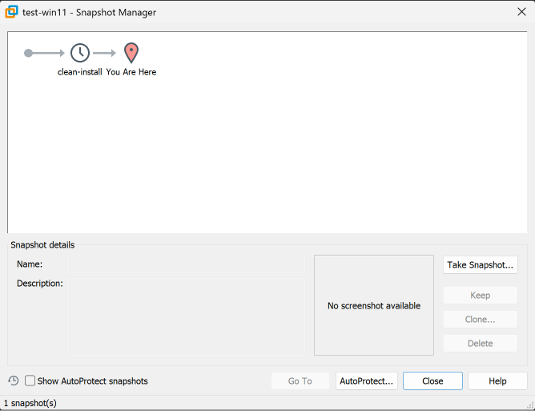

# How to build a test machine: Ubuntu Server and Windows 11 in VMware

**Who this is for.** Someone who has never used a virtual machine. Follow the steps in order and do nothing
that is not written here. After the important steps there is a **Check** — if what you see is different, stop
and look at “If something goes wrong” at the end.

**What you get.** Two “computers inside your computer” (virtual machines): one Ubuntu Server, one Windows 11.
The developer can break anything inside them and you can put them back to a clean state in one minute
(step 9 and step 17). Nothing he does inside them can damage the real laptop.

---

## Before you start

You need:

- A Windows laptop with **at least 16 GB of memory** and **at least 120 GB of free disk space**.
  Both machines together use 12 GB of memory while running, and the laptop itself needs the rest.
- **Virtualization enabled** in the laptop's firmware (BIOS/UEFI). To check: open Task Manager → Performance →
  CPU. The line **Virtualization: Enabled** must be there. If it says Disabled, ask IT to enable it — nothing
  below will work without it.
- About **2 hours**, mostly waiting for installers.

---

## Part 1. VMware

### Step 1. Install VMware Workstation Pro

Download VMware Workstation Pro (this document was written on version 26H1u1) from the Broadcom support portal (support.broadcom.com → free account →
Downloads → VMware Workstation Pro) and install it with the default options.

**Why VMware Workstation Pro:** it is free for companies as well as individuals (since November 2024) and needs
no licence key. VirtualBox is also free and would work, but all the screenshots in this document are VMware.



### Step 2. Download the two installation images

- **Ubuntu Server LTS** — ubuntu.com/download/server. Take the **LTS** version (Long Term Support: 5 years of
  updates). This document was written with `ubuntu-26.04.1-live-server-amd64.iso`.
- **Windows 11 Enterprise Evaluation** — Microsoft Evaluation Center. Do **not** type in a licence key of your own
  and do **not** download “pre-activated” copies from other sites.

Save both `.iso` files in one folder you will remember, e.g. `C:\ISO`.

**Why Server and not Desktop Ubuntu:** a developer's test server has no graphical desktop in real life either,
and Server uses about half the memory.

**Important:** the Windows Evaluation works for **90 days**. That is fine for testing; it is not a licence for
everyday work.

---

## Part 2. The Ubuntu machine

### Step 3. Start the New Virtual Machine wizard

In VMware: **File → New Virtual Machine… → Typical → Next.**
On the next page choose **“I will install the operating system later”** → Next.

**Why “later”:** if you point VMware at the ISO here, it runs “Easy Install”, which answers the installer's
questions for you and hides choices we need to make ourselves (step 7).



### Step 4. Choose the system type and the name

Guest operating system: **Linux**, version: **Ubuntu 64-bit** → Next.
Name: `test-ubuntu`. Location: leave as offered → Next.

**Why the name matters:** in a month there will be several machines; a name that says what it is saves
guessing.

### Step 5. Disk size

Maximum disk size: **25 GB**. Leave “Split virtual disk into multiple files” as it is → Next.

**Why 25 GB:** Ubuntu Server itself takes about 5 GB; the rest is room for the developer's tools and data. The
disk is **dynamic**: it starts small and grows only as files are written, so 25 GB is a ceiling, not space taken
today.



### Step 6. Memory, processors, network, ISO

On the last page press **Customize Hardware…** and set:

| Item | Set to | Why |
|---|---|---|
| Memory | **4096 MB** (4 GB) — the wizard suggests 6144 MB, lower it | Enough for Ubuntu Server with room for the developer's programs; with 6 GB here and 8 GB for Windows the laptop would be left with almost nothing |
| Processors | **2** (already set) | Two cores are enough for server tasks and leave the laptop most of its cores |
| New CD/DVD | **Use ISO image file** → choose the Ubuntu `.iso` from step 2 | This is the installer disc |
| Network Adapter | **NAT** | Explained below |

**Why NAT and not Bridged or Host-only.** With NAT the virtual machine reaches the internet through the laptop
and can talk to the other virtual machine, but nobody on the office network can reach it. Bridged would give it
its own place on the office network — on networks that filter devices by MAC address (the campus network does)
it simply gets no connection. Host-only has no internet at all, and the developer needs it to install software.



Press **Close → Finish**.

### Step 7. Install Ubuntu

Press **Power on this virtual machine**. Click inside the black window to type (press **Ctrl+Alt** to get the
mouse back). Use the arrow keys and Enter:

1. Language **English**, keyboard **English (US)** → Done.
2. Type of install: **Ubuntu Server** → Done.
3. Network: the screen shows an address like `192.168.x.x` — leave it → Done.
4. Proxy: leave empty → Done.
5. Mirror: wait for **“This mirror location passed tests”** → Done.
   If it does not pass, the machine has no internet — stop and see “If something goes wrong”.
6. Storage: **Use an entire disk** → Done → **Continue**.
   This erases only the *virtual* 25 GB disk from step 5, not the laptop.
7. Profile: your name, server name `test-ubuntu`, a username and a password. **Write the password down** — there
   is no way to see it later.
8. Upgrade to Ubuntu Pro: **Skip for now**.
9. SSH: **tick “Install OpenSSH server”**.
10. Featured snaps: tick nothing → Done.
11. Wait for **Reboot Now**, press it. If it asks to remove the installation medium, press Enter.

**Why tick OpenSSH:** it lets you copy files to and from the machine and lets the developer connect from his own
terminal. If you forget it, SSH has to be installed and switched on by hand afterwards.



### Step 8. Check that Ubuntu works

Log in with the username and password from step 7, then type:

```bash
ip addr
ping -c 4 8.8.8.8
sudo apt update
```

> **Check:** `ip addr` shows an address like `192.168.x.x` next to `ens33`. `ping` shows four replies and
> `0% packet loss`. `apt update` ends without red “Err” lines.



### Step 9. Take the “clean” snapshot

Shut the machine down cleanly: `sudo poweroff`.
Then in VMware: **VM → Snapshot → Take Snapshot…**, name it `clean-install`, press **Take Snapshot**.

**Why:** this is the “undo” button for the whole machine. Whatever the developer breaks, **VM → Snapshot →
Revert to Snapshot** returns the machine to exactly this moment.

---

## Part 3. The Windows machine

### Step 10. New Virtual Machine wizard

**File → New Virtual Machine… → Typical → “I will install the operating system later”.**
Guest operating system: **Microsoft Windows**, version: **Windows 11 x64**. Name: `test-win11`.

### Step 11. Encryption (Windows 11 only)

VMware now asks about **encryption**. Choose **“Only the files needed to support a TPM are encrypted”** and
enter a password. **Write this password down and keep it with the laptop's documents** — without it the
machine will not open again.

**Why:** Windows 11 refuses to install without a TPM security chip. VMware gives the virtual machine a virtual
TPM, and it requires this encryption to do so.



### Step 12. Disk, memory, processors, network

Disk: leave **64 GB** as offered (Windows 11 needs at least 64 GB). Then **Customize Hardware…**:

| Item | Set to | Why |
|---|---|---|
| Memory | **8192 MB** (8 GB) — the wizard suggests 4096 MB, raise it | Windows 11 needs at least 4 GB and is slow below 8 |
| Processors | **2** (already set) | Windows 11 needs at least 2; the laptop keeps the rest |
| New CD/DVD | **Use ISO image file** → the Windows `.iso` | The installer disc |
| Network Adapter | **NAT** | Same reason as step 6 — and both machines must be on the same network to see each other |

### Step 13. Install Windows

Power on. If you see “Press any key to boot from CD or DVD”, click inside the window and press a key quickly.

1. Language and keyboard → Next → **Install now**.
2. Accept the licence terms. Choose **Custom: Install Windows only** and the single disk shown → Next.
   Again, this is only the virtual disk.
3. After several restarts, the setup asks you to sign in. Do **not** sign in with a Microsoft account: choose
   **Sign-in options → Domain join instead**, then enter a username, a password (**write it down**) and answer
   the three security questions.
   **Why:** a local account does not tie the test machine to anybody's personal Microsoft account.
4. Privacy settings: switch everything **off** → Accept.

### Step 14. Install VMware Tools

When the desktop appears: **VM → Install VMware Tools…**, open the DVD drive in File Explorer, run
`setup64.exe`, accept the defaults, restart.

**Why:** without it the screen does not resize, the mouse sticks, and the network works more slowly.

### Step 15. Allow ping through the firewall

Ubuntu cannot “ping” Windows yet: Windows' firewall blocks it. **Do not switch the firewall off.** Open
PowerShell **as administrator** (right-click → Run as administrator) and type:

```powershell
New-NetFirewallRule -DisplayName "Allow ping (ICMPv4 echo)" -Direction Inbound -Protocol ICMPv4 -IcmpType 8 -RemoteAddress LocalSubnet -Action Allow
```

**Why this and not turning the firewall off:** this rule opens exactly one thing — ping — and only for machines
on the same virtual network. Everything else stays protected.

### Step 16. Check that both machines see each other

On Windows, in PowerShell: `ipconfig` — note the IPv4 address (like `192.168.x.x`). Then:

```powershell
ping 8.8.8.8
ping <the Ubuntu address from step 8>
```

On Ubuntu:

```bash
ping -c 4 <the Windows address>
```

> **Check:** all three pings get replies. If Ubuntu → Windows fails but Windows → Ubuntu works, step 15 was not
> done in an administrator PowerShell.

### Step 17. Take the “clean” snapshot

Shut Windows down (Start → Power → Shut down), then **VM → Snapshot → Take Snapshot…** → `clean-install`.



---

## If something goes wrong

| What you see | What it means | What to do |
|---|---|---|
| “Virtualization is disabled” / the machine will not start | Virtualization is off in the laptop's firmware | Ask IT to enable it (see “Before you start”) |
| Ubuntu mirror test fails, or `ping 8.8.8.8` gets no reply | The machine has no internet | Check the laptop itself has internet; check the network adapter is **NAT** (step 6) |
| Ubuntu cannot ping Windows, Windows can ping Ubuntu | Windows firewall | Repeat step 15 in an **administrator** PowerShell |
| `ssh: connect ... refused` | SSH is not running (step 7, item 9 was skipped) | On Ubuntu: `sudo apt install openssh-server` then `sudo systemctl enable --now ssh` |
| Windows machine asks for a password on opening | Encryption from step 11 | Use the password you wrote down |
| The developer broke something | That is what the machines are for | Shut the machine down → **VM → Snapshot → Revert to Snapshot** |
